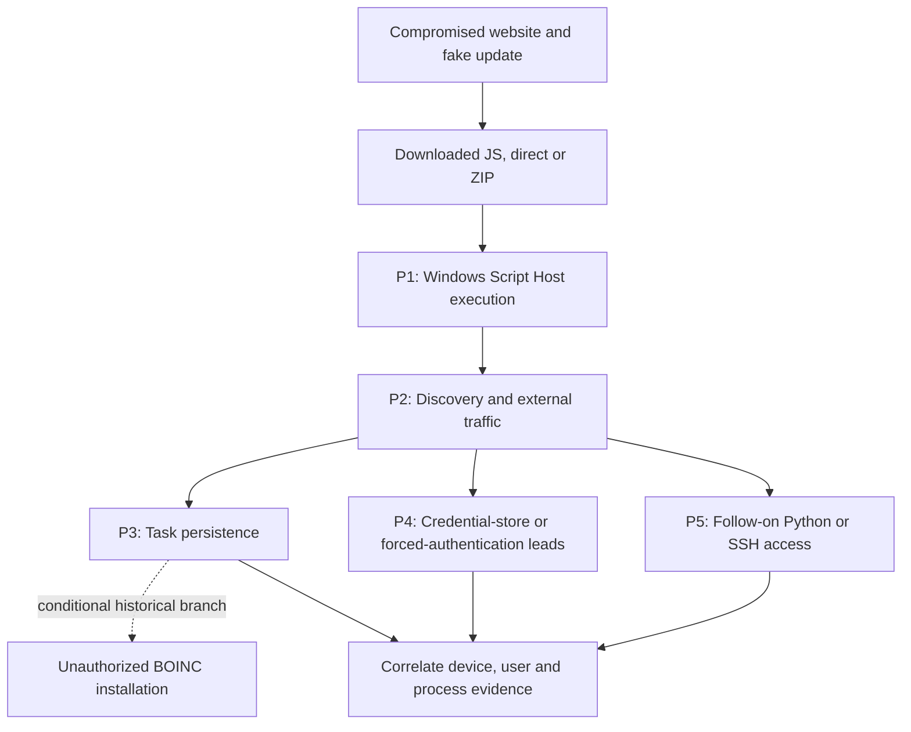

# H-0010: SocGholish fake-update execution and follow-on intrusion

Status: planning; source-backed, analyst-curated hunt package. No production hunt has been executed. Review field mappings and coverage before using these candidate queries.

## LEARN: Prepare the Hunt

### Hypothesis Statement

Managed Windows endpoints that execute a downloaded fake-update JavaScript payload may show a correlated sequence of script execution, external traffic and discovery. A subset may progress to task persistence, credential access or tunneling. Test each branch independently, then correlate by device, user and process lineage. Shared behaviors require provenance and corroboration before attributing them to SocGholish.

### Threat Context

Source CTI:

> MITRE ATT&CK Techniques: T1059.007, T1204.002, T1482, T1053.005, T1555.003, T1003.002, T1572, T1187, T1071.001, T1033

- Trend Micro's March 2025 investigation describes user-launched wscript JavaScript (T1204.002, T1059.007), tasks (T1053.005), browser-store copying (T1555.003), certutil shadow-copy hive access (T1003.002) and SSH tunneling (T1572). [S1](https://www.trendaisecurity.com/en-us/resources-insights/trendai-security-blog/socgholishs-intrusion-techniques-facilitate-distribution-of-rans)
- Red Canary's 2025 observations support correlating script-host execution with external connections and nltest trust enumeration (T1482). [S2](https://redcanary.com/threat-detection-report/threats/socgholish/)
- Darktrace's separate 2025 cases document WebDAV authentication attempts and share-hosted SCF files (T1187), plus HTTPS traffic (T1071.001). [S3](https://www.darktrace.com/blog/socgholish-from-loader-and-c2-activity-to-ransomhub-deployment)
- Huntress's July 2024 branch supports investigating unauthorized BOINC tasks with explicit uncertainty. [S4](https://www.huntress.com/blog/fake-browser-updates-lead-to-boinc-volunteer-computing-software)
- Infoblox's June 2026 analysis requires separating delivery from endpoint C2 and exposure from compromise. [S5](https://www.infoblox.com/blog/threat-intelligence/hot-take-operation-endgame-vs-socgholish/)

The five-report [dossier](../../../research/R-0972.md#combined-cti-input) preserves source dates, evidence boundaries and the exact input fed to Hecate. [R-0972](../../../research/R-0972.md) records the curated research review. These sources establish no Washington election compromise. Scope election assets only after obtaining a verified asset inventory.

### Grounding

> Every checkable claim in this draft traces back to a source.

*10 asserted by CTI · 0 research-only · 0 inferred · 0 unsupported*

| Claim | Type | Grounding |
|-------|------|-----------|
| `T1059.007` | technique | asserted by CTI — named by the source CTI |
| `T1204.002` | technique | asserted by CTI — named by the source CTI |
| `T1482` | technique | asserted by CTI — named by the source CTI |
| `T1053.005` | technique | asserted by CTI — named by the source CTI |
| `T1555.003` | technique | asserted by CTI — named by the source CTI |
| `T1003.002` | technique | asserted by CTI — named by the source CTI |
| `T1572` | technique | asserted by CTI — named by the source CTI |
| `T1187` | technique | asserted by CTI — named by the source CTI |
| `T1071.001` | technique | asserted by CTI — named by the source CTI |
| `T1033` | technique | asserted by CTI — named by the source CTI |

### Attack-flow and hunt prongs

A complete chain is not required to retain a lead. Browser association can come from history or ancestry; Explorer and archive utilities can mediate execution. No rule requires a universal UpdateCheck task, fabricated election lure, registry Run key or successful ransomware deployment.

## OBSERVE: Expected Behaviors

| Prong | Candidate evidence | Corroboration and limitations |
|---|---|---|
| P1: delivery/execution | Rules 01; downloaded JS and Mark-of-the-Web; browser/archive/Explorer lineage | Inspect original filename, script content, origin URL and signature/hash. Unicode normalization is a pivot, not proof. Administrative JS can match. |
| P2: discovery/egress | Rules 02–03; script process, nltest, DNS and network records | Join device + process GUID/entity + user; initial review window 15 minutes. In-memory reconnaissance may have no child command. |
| P3: persistence | Rule 04; task XML, action, trigger and principal | Look forward 24 hours. Optional renamed BOINC branch requires file identity and unauthorized project/task evidence; presence alone is insufficient. |
| P4: credential exposure | Rules 05–07 and 09; copy operations, SCF content, proxy/auth/share logs | Confirm access outcome. SCF filename and WebDAV user agent are leads; neither proves hashes stolen. Process-copy rule misses direct file reads. |
| P5: follow-on access | Rule 08; Python execution and task ancestry; rare destinations | Approved SSH tunnels can match. Python backdoors and changing ports are conditional pivots, not universal indicators. |

### Collection prerequisites and normal activity

| Data | Required fields / collection |
|---|---|
| Process | Device, UTC time, process GUID/entity, image, command line, parent GUID/image, user SID; EDR/Sysmon 1 or Security 4688 |
| Network | Device/process attribution, UTC time, destination IP/port, initiated/direction; EDR/Sysmon 3; DNS/proxy as context |
| Task | Security 4698/4702 with TaskContent XML; TaskScheduler logs and current task inventory |
| File | Target path, creating process, UTC time; content acquisition separately for SCF; EDR/Sysmon 11 does not prove file reads |
| Credential pivots | EDR file-access/command/script visibility; 4104 if enabled; auth 4624/4625 and share access 5140/5145 where collected |
| Web | Proxy user-agent, destination and user/device identity; HTTPS visibility and connector mappings must be verified |

Collect a seven-day retrospective where retained; use a 30-day baseline if available for sanctioned scripts, support tools, backup/profile migration, tasks, BOINC projects and SSH forwarding. These are proposed windows. Document actual retention before searching. Current production SIEM/EDR ingestion is unverified; query provider is mock.

## CHECK: Execute and Analyze

### Detection package

Nine experimental Sigma rules; 46 native query files. All rules parse with pySigma and pass one illustrative positive plus two benign/near-miss fixtures each (27 checks). This is predicate testing, not measured production precision or recall. Rule references establish behavioral rationale, not exact reproduction of commands from a report. Synthetic addresses are documentation addresses.

| Rule | Sigma | Native queries available |
|---|---|---|
| 01 | [Windows Script Host Executes JavaScript From User Writable Directory](../../../queries/H-0010/01_script_from_user_directory.yml) | [KQL](../../../queries/H-0010/01_script_from_user_directory.kql) · [CQL](../../../queries/H-0010/01_script_from_user_directory.cql) · [LEQL](../../../queries/H-0010/01_script_from_user_directory.leql) · [SPL](../../../queries/H-0010/01_script_from_user_directory.spl) · [EQL](../../../queries/H-0010/01_script_from_user_directory.eql) |
| 02 | [Windows Script Host Initiates Connection Beyond Local Address Ranges](../../../queries/H-0010/02_script_public_egress.yml) | [SPL](../../../queries/H-0010/02_script_public_egress.spl) · [EQL](../../../queries/H-0010/02_script_public_egress.eql) |
| 03 | [Domain Trust Enumeration With Nltest](../../../queries/H-0010/03_nltest_trusts.yml) | [KQL](../../../queries/H-0010/03_nltest_trusts.kql) · [CQL](../../../queries/H-0010/03_nltest_trusts.cql) · [LEQL](../../../queries/H-0010/03_nltest_trusts.leql) · [S1QL](../../../queries/H-0010/03_nltest_trusts.s1ql) · [SPL](../../../queries/H-0010/03_nltest_trusts.spl) · [EQL](../../../queries/H-0010/03_nltest_trusts.eql) |
| 04 | [Scheduled Task Action Runs Script Or Python From User Writable Path](../../../queries/H-0010/04_task_script_userpath.yml) | [KQL](../../../queries/H-0010/04_task_script_userpath.kql) · [CQL](../../../queries/H-0010/04_task_script_userpath.cql) · [LEQL](../../../queries/H-0010/04_task_script_userpath.leql) · [SPL](../../../queries/H-0010/04_task_script_userpath.spl) · [EQL](../../../queries/H-0010/04_task_script_userpath.eql) |
| 05 | [Certutil References Shadow Copy Registry Hives](../../../queries/H-0010/05_certutil_shadow_hives.yml) | [KQL](../../../queries/H-0010/05_certutil_shadow_hives.kql) · [CQL](../../../queries/H-0010/05_certutil_shadow_hives.cql) · [LEQL](../../../queries/H-0010/05_certutil_shadow_hives.leql) · [S1QL](../../../queries/H-0010/05_certutil_shadow_hives.s1ql) · [SPL](../../../queries/H-0010/05_certutil_shadow_hives.spl) · [EQL](../../../queries/H-0010/05_certutil_shadow_hives.eql) |
| 06 | [Command Shell Or PowerShell Copies Browser Login Store](../../../queries/H-0010/06_browser_store_copy.yml) | [KQL](../../../queries/H-0010/06_browser_store_copy.kql) · [CQL](../../../queries/H-0010/06_browser_store_copy.cql) · [LEQL](../../../queries/H-0010/06_browser_store_copy.leql) · [S1QL](../../../queries/H-0010/06_browser_store_copy.s1ql) · [SPL](../../../queries/H-0010/06_browser_store_copy.spl) · [EQL](../../../queries/H-0010/06_browser_store_copy.eql) |
| 07 | [Thumbs SCF File Created](../../../queries/H-0010/07_thumbs_scf.yml) | [KQL](../../../queries/H-0010/07_thumbs_scf.kql) · [CQL](../../../queries/H-0010/07_thumbs_scf.cql) · [LEQL](../../../queries/H-0010/07_thumbs_scf.leql) · [S1QL](../../../queries/H-0010/07_thumbs_scf.s1ql) · [SPL](../../../queries/H-0010/07_thumbs_scf.spl) · [EQL](../../../queries/H-0010/07_thumbs_scf.eql) |
| 08 | [OpenSSH Client Uses Remote Forwarding](../../../queries/H-0010/08_ssh_remote_forward.yml) | [KQL](../../../queries/H-0010/08_ssh_remote_forward.kql) · [CQL](../../../queries/H-0010/08_ssh_remote_forward.cql) · [LEQL](../../../queries/H-0010/08_ssh_remote_forward.leql) · [S1QL](../../../queries/H-0010/08_ssh_remote_forward.s1ql) · [SPL](../../../queries/H-0010/08_ssh_remote_forward.spl) · [EQL](../../../queries/H-0010/08_ssh_remote_forward.eql) |
| 09 | [Windows WebDAV Redirector Traffic Candidate](../../../queries/H-0010/09_webdav_useragent.yml) | [CQL](../../../queries/H-0010/09_webdav_useragent.cql) · [LEQL](../../../queries/H-0010/09_webdav_useragent.leql) · [SPL](../../../queries/H-0010/09_webdav_useragent.spl) · [EQL](../../../queries/H-0010/09_webdav_useragent.eql) |

KQL process/file/network outputs use Microsoft Defender tables. Task KQL is an analyst-authored alternative requiring the actual WindowsEvent connector and parsed EventData.TaskContent, with Provider filtering; it is not an MDE DeviceEvents equivalent. [Microsoft schema](https://learn.microsoft.com/en-us/azure/azure-monitor/reference/tables/windowsevent). WebDAV EQL explicitly assumes ECS user_agent.original. Other outputs use installed vendor conversion pipelines; confirm indices, datasets and field mappings locally before executing. Add bounded time filters through the SIEM search window where a generated query has none.

### Correlation and triage procedure

1. Start with rule 01. Retrieve full parent/child lineage, JS origin, file hash, original Unicode filename, browser download history and available script content. Preserve source artifacts with UTC timestamps.
2. Join rule 02 network events and rule 03 discovery by stable device/process identifiers within 15 minutes; PID alone can be reused. Proxy NAT address alone is insufficient. Expand to sibling and descendant processes.
3. Search forward 24 hours for rule 04 task actions and rule 08 tunneling; inspect task XML and file identity. For BOINC, verify actual client/project configuration and authorization. ExpirienceHost is a marker, not Run-key persistence.
4. Investigate rules 05–07/09 with file, authentication and share evidence. For SCF, acquire content and check IconFile UNC destination against approved infrastructure. Record attempted, blocked and successful actions separately.
5. Pivot by confirmed file hashes, source URLs, user SID, task actions and stable device identity across the environment. Historical TDS/C2 values remain dated research pivots until independently revalidated.

### Validation and rejection record

Full per-rule fixtures and conversion diagnostics: [validation JSON](../../../research/R-0972.md#validation-record).

The initial pipeline generated five rules and replayed five against 51 simulated events: two validated, zero benign-sample matches. Those numbers describe the original package only. The final curated suite has its separate 27 predicate tests; it has not been validated by live CALDERA or a production SIEM. Preliminary local backups were removed after curation; the combined input and final validation record are retained in R-0972.

The pipeline rejected a file rule using `\pypa.py` and a process rule using `/create`: its exact-value guard did not accept those strings. They are replaced by analytically specified candidates with stated telemetry assumptions, not silently labeled model-approved. The final scope also removes unsupported Run-key/process-injection mappings and unrelated similarity links. Failed or semantically incorrect translations are not included as deployable files:

- Rule 01, `sentinelone_s1ql`: Syntax validation failed: Unterminated double quote in query; Unclosed delimiter '(' opened at position 35; Unclosed delimiter '(' opened at position 63; Unclosed delimiter '(' opened at position 198
- Rule 02, `sentinel_kql`: Semantic review: Initiated constraint was dropped and IPv6 CIDRs were passed to ipv4_is_in_range. Do not deploy this conversion.
- Rule 02, `crowdstrike_cql`: ORing CIDR matching is not yet supported by LogScale backend
- Rule 02, `rapid7_leql`: Boolean value True not supported by the backend. (while converting rule None)
- Rule 02, `sentinelone_s1ql`: Invalid SigmaDetectionItem field name encountered: Initiated. 
- Rule 04, `sentinelone_s1ql`: Invalid SigmaDetectionItem field name encountered: EventID. Invalid SigmaDetectionItem field name encountered: Initiated. 
- Rule 09, `sentinel_kql`: HTTP KQL requires an explicit deployed table and field mapping; generic Sigma field names must not become quoted string constants
- Rule 09, `sentinelone_s1ql`: Invalid SigmaDetectionItem field name encountered: c-useragent. Invalid SigmaDetectionItem field name encountered: EventID. Invalid SigmaDetectionItem field name encountered: Initiated. 

The initial task KQL conversion failed on TaskContent under MDE; the explicit WindowsEvent alternative resolves that file only. The script-egress KQL was removed after semantic review found lost direction and invalid IPv6 handling. No broad rule, stale IOC list or parser pass alone proves SocGholish compromise.

Published Atomic references for a future Windows lab: Red Canary lists T1059.007 test 2, T1033 test 6 and T1482 test 2. Review current upstream procedures and expected sensors before executing. No live BAS was launched; the configured CALDERA lab is Linux and cannot establish this Windows chain's detection coverage.

## KEEP: Findings and Response

No production events analyzed; no true or false positives recorded. Escalate a corroborated malicious script chain, credential-access attempt or unauthorized persistent access with device/user/process timelines, preserved payload/script and task evidence, destination role and confidence, and observed prevention outcomes. Apply the organization's approved isolation and credential-response process after confirming scope. A clean search with missing telemetry remains inconclusive.

Record per-prong telemetry availability, candidate counts, corroborated chains, benign explanations, sensor gaps, tuning decisions and retained evidence. Human review is still required for deployment. H-0010 remains planning.
